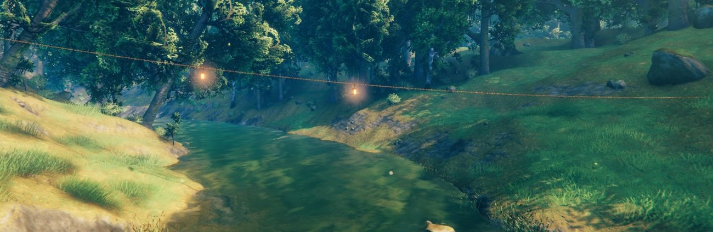
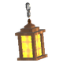
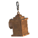
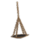
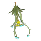
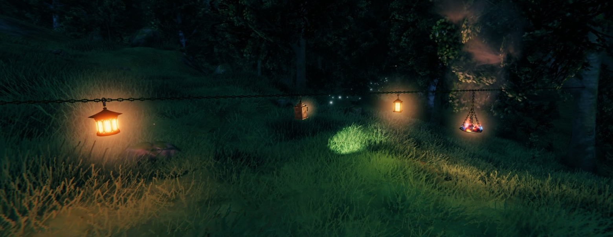
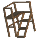
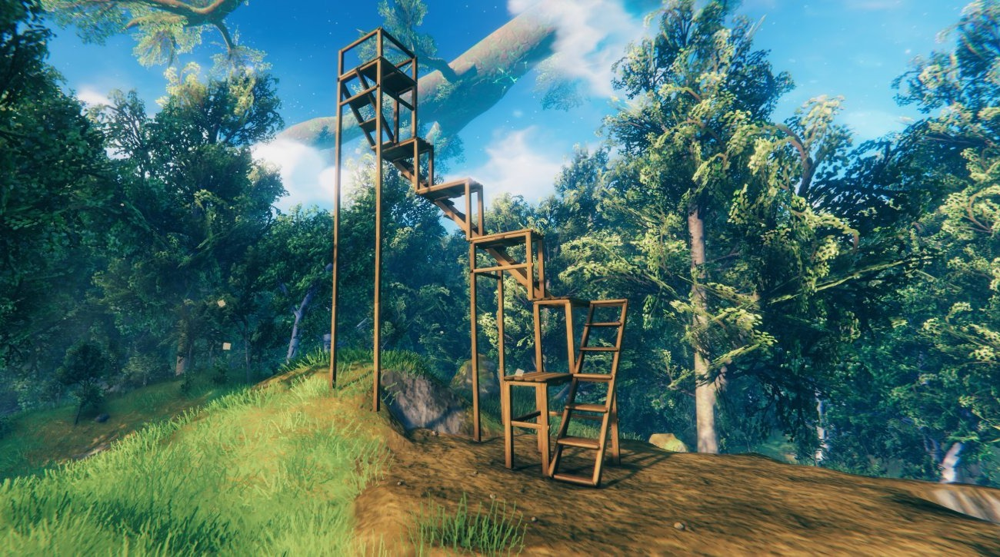
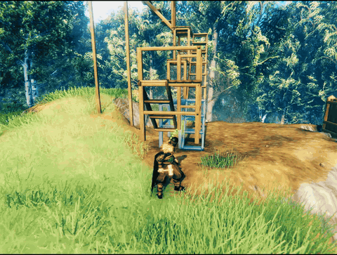

Building pieces for Valheim that the game doesn't have: wooden mannequins to dress in your armor, in every stance and emote; ropes and chains to hang between any two points; lanterns, a brazier, herbs and bunting to hang on them; and scaffolding to climb. More will join over time, all built from the hammer.

   

**Ask and Embla** are wooden mannequins, named for the first man and woman, whom Odin and his brothers made from two trees on the shore. Ask has the male body and Embla the female. Each comes in the game's 15 armor stand stances and in all 25 emotes, so a mannequin can wave, sit, cheer or flex while it shows off your gear.

- Build them with the hammer: 8 Fine Wood, 2 Bronze Nails and 4 Tar, at a workbench, like the game's armor stand.
- Dress them like an armor stand: armor, capes and weapons. Painted armor shows on the body, and comes off with it.
- Pick a colour before you build, in the panel beside the build menu: natural wood, or any hue with saturation and brightness. The same panel switches the wooden base on or off. To recolour a mannequin you've already built, place one of that colour on it.

The mannequins sit under one fold-open Mannequins entry in the build menu, opening to Ask's and Embla's stances and emotes, so 80 pieces don't crowd the rest of the menu. With Potato Hammer, the entry sits right under the Potato Wright tab. Every stance has its own icon, drawn in the style of the game's emote icons.

   

**Ropes and chains** hang between any two points you choose, for rigging, fences, gates, a hall's beams or a ship. A twisted three-strand rope, and chains of real links in iron, bronze and spiked black metal.

- Click the first end, roll the mouse wheel to set how much it sags, then click the second end. They snap to building pieces' snap points like any piece; hold Shift to place freely.
- Up to 48 m long, or 64 m when the server turns on the setting at the end of this page, for one price whatever the length. Rope: 2 Leather Scraps, at a workbench. Iron, bronze or black metal chain: 1 bar of that metal, at a forge.
- If either end loses what it hangs from, the rope or chain falls and drops its materials.

They're decoration: nothing can be built on them except the hangings below, and rain and weather leave them alone. With Build On Ship, they ride on your ship and stay up while it sails.

     

**Things to hang** go on a rope or chain you've already built: aim at it and click. Three lanterns, a brazier, a bunch of drying herbs, and pennant bunting that runs the whole length.

| Piece | What it is | Cost |
|---|---|---|
| Hanging lantern: Dvergr | The Dvergr lantern on a short chain, lit like the game's | 1 Bronze, 2 Resin, at a forge |
| Hanging lantern: hooded | Throws its beam out and down; roll the mouse wheel to turn it before you click | 3 Frostwood, 1 Glow Worm, at a forge |
| Hanging lantern: Deep North | The Deep North's iron lamp | 1 Salvaged Lantern, 1 Chain, at a forge |
| Hanging brazier | The game's hanging brazier; burns coal and warms like it | 5 Bronze, 2 Coal, 1 Chain, at a forge |
| Drying herbs | Thistles and dandelions, heads down | 1 Thistle, 2 Dandelions, at a workbench |
| Pennant bunting | Flags along the whole rope or chain; the mouse wheel picks many colours, banner cloth or one colour, with or without Elder Futhark runes | 2 Leather Scraps, 2 Raspberries, at a workbench |

The mouse wheel works on the hanging while you aim at a rope or chain, and the camera holds still. Anything hung falls, dropping its materials, when its rope or chain goes.

**Scaffolding** is a wooden frame to climb and build from: a ladder on one side, a plank deck on the other, 4 Wood at a workbench. Frames snap together at their corners, stack straight up or step up as stairs, and open into each other where they meet. The top frame gets a guard rail. Every third step up a stair stands on long legs down to the ground, so a tall stair doesn't hang on its lowest frame alone.

A frame falls when what it stands on is removed and nothing else holds it. A frame on long legs stays up, and so does everything resting on it.

Hangings and scaffolding work on ships with Build On Ship too.

The one setting is for the server owner, in Configuration Manager (the server's value goes to everyone):

| Setting | Default | What it does |
|---|---|---|
| Ropes and chains: longest | Off | Ropes and chains reach 64 m instead of 48 m. 64 m is the longest that still shows for every player at either end, whatever their simulation distance. |

Everyone needs the mod, the server included, because the pieces are part of your world. Dedicated servers load it too. It's part of the PotatoServer pack for the Potato Server.

Bug reports go to [GitHub Issues](https://github.com/TheRealRel/PotatoWright/issues), where the source lives too. Questions are welcome on Discord: [relanebeis](https://discord.com/users/373574370267889674).

Needs [BepInExPack Valheim](https://thunderstore.io/c/valheim/p/denikson/BepInExPack_Valheim/) and [Jötunn](https://thunderstore.io/c/valheim/p/ValheimModding/Jotunn/).

The code is under the MIT License. The icon, page icons and screenshots are © TheRealRel under [CC BY-NC 4.0](https://creativecommons.org/licenses/by-nc/4.0/): free to share and adapt with credit, but not for commercial use. See LICENSE for the details.

<!--
 $$$$$$$$$$$$$$$$""$o$o$o$o$o$oo$$""$$$$$$$$$$$$$$$
$$$$$$$$$$$$""o$$$$$$$$$$"$"$$$$$$$o$"$$$$$$$$$$$$
$$$$$$$$$"$o$$$$""$oo $ ""      """$$$oo"$$$$$$$$$
$$$$$$$"o$$$$"   ""o  $oo o o       ""$$$o"$$$$$$$
$$$$$"o$$$"       oo$$$$$$$$$$o        "$$$o"$$$$$
$$$$"o$$$  $  o$$$$$$$$$$$$$$"$$oo       "$$$ $$$$
$$$"$$$"   "$$$$$$$$$$$$$$$$o$o$$$"        $$$o$$$
$$ $$$    o$$$$$$$$$$$$$$$$$$$$$$$$o o   o  "$$o"$
$"$$$"    o$$$$$$$$$"$$$$$$"" "$$$$$$"$$$$$  $$$"$
$o$$"    o$$$$$$$$$$o""$$$""""ooo"$$$$$$$$"   $$$"
$o$$"    o$$$$$$$$$$            ""oo"$"$o""   $$$o
o$$$     o$$$$$$$$$$                """""$    o$$o
o$$$    o$$$$$$$$$$$$o                   "o "oo$$o
o$$$  oo$$$$$$$$$$$$$$$$ooooooo$$$$$oo    $"$ "$$o
o$$$"  ""  $$$$$$$$$$$$$$$$$$$$$$$$$$$$o    " $$$
$ $$$       "$$$$$$$$$$$$$$$$$$$$$$$$$$$o    o$$"$
$$"$$o       "$$$$$$$$$$$$$$$$$$$$$$$$$$$o   $$$o$
$$o$$$o       $$""$$$$$$$$$$$$$$$$$$$$$$$o  $$$ $$
$$$o"$$o    "$""  "$""$$$$$$$$$$$$$$$$$$$oo$$$"$$$
$$$$o"$$$o        "     $$$$$$$$$$$$$$$$$o$$"o$$$$
$$$$$$o"$$$o         oo$$$$$$$$$$$$$$$$$$$$"o$$$$$
$$$$$$$$o"$$$$ooooo$$$$$$$$$$$$$$$$$$$$$$"o$$$$$$$
$$$$$$$$$$o""$$$$$$$$$$$$$$$$$$$$$$$$$"oo$$$$$$$$$
$$$$$$$$$$$$$o$""$$$$$$$$$$$$$$$$$""oo$$$$$$$$$$$$
$$$$$$$$$$$$$$$$$$o$o$"$"$"$"$oo$o$$$$$$$$$$$$$$$$
-->
