Building pieces for Valheim that the game doesn't have. The first two: wooden mannequins to dress in your armor, in every stance and emote, and ropes and chains to hang between any two points. More will join over time, all built from the hammer.

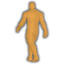 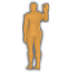 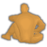 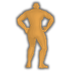

**Ask and Embla** are wooden mannequins, named for the first man and woman, whom Odin and his brothers made from two trees on the shore. Ask has the male body and Embla the female. Each comes in the game's 15 armor stand stances and in all 25 emotes, so a mannequin can wave, sit, cheer or flex while it shows off your gear.

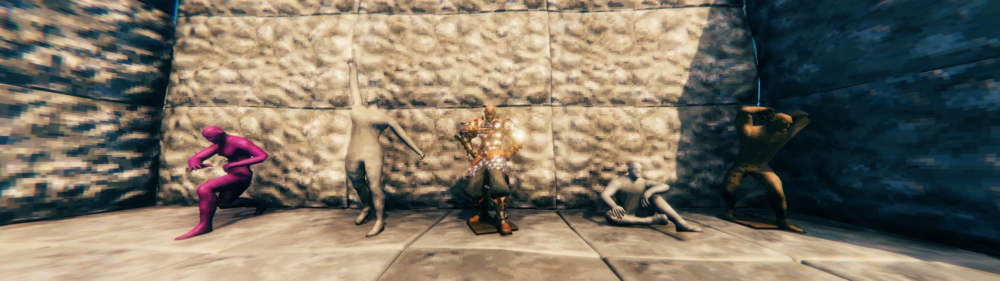

- Build them with the hammer: 8 Fine Wood, 2 Bronze Nails and 4 Tar, at a workbench, like the game's armor stand.
- Dress them like an armor stand: armor, capes and weapons. Painted armor shows on the body, and comes off with it.
- Pick a colour before you build, in the panel beside the build menu: natural wood, or any hue with saturation and brightness. The same panel switches the wooden base on or off. To recolour a mannequin you've already built, place one of that colour on it.

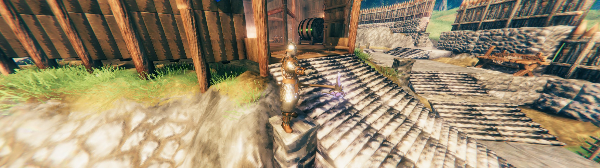

The mannequins sit under one fold-open Mannequins entry in the build menu, opening to Ask's and Embla's stances and emotes, so 80 pieces don't crowd the rest of the menu. With Potato Hammer, the entry sits right under the Potato Wright tab. Every stance has its own icon, drawn in the style of the game's emote icons.

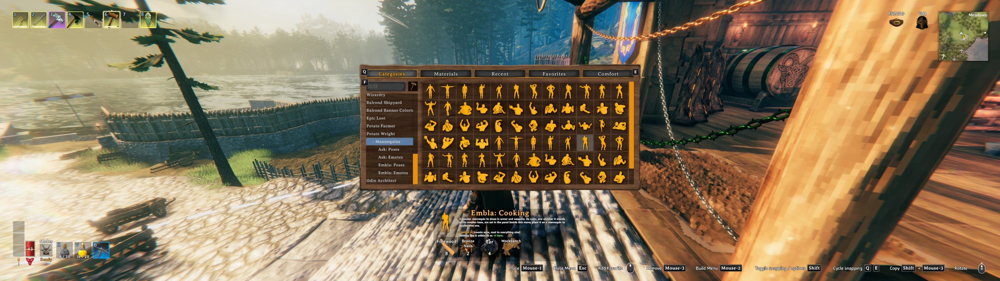

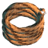 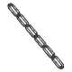 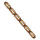 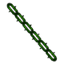

**Ropes and chains** hang between any two points you choose, for rigging, fences, gates, a hall's beams or a ship. A twisted three-strand rope, and chains of real links in iron, bronze and spiked black metal.

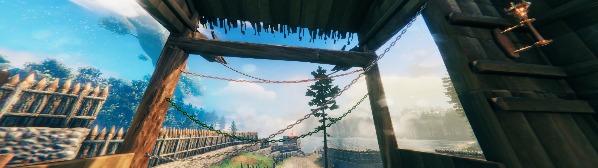

- Click the first end, roll the mouse wheel to set how much it sags, then click the second end. They snap to building pieces' snap points like any piece; hold Shift to place freely.
- Up to 16 m long, for one price whatever the length. Rope: 2 Leather Scraps, at a workbench. Iron, bronze or black metal chain: 1 bar of that metal, at a forge.
- If either end loses what it hangs from, the rope or chain falls and drops its materials.

They're decoration: nothing stands on them and they don't hold anything up, and rain and weather leave them alone. With Build On Ship, they ride on your ship and stay up while it sails.

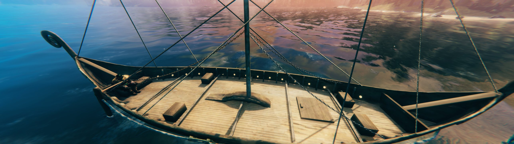

Everyone needs the mod, the server included, because the pieces are part of your world. Dedicated servers load it too. It's part of the PotatoServer pack for the Potato Server.

Bug reports go to [GitHub Issues](https://github.com/TheRealRel/PotatoWright/issues), where the source lives too. Questions are welcome on Discord: [relanebeis](https://discord.com/users/373574370267889674).

Needs [BepInExPack Valheim](https://thunderstore.io/c/valheim/p/denikson/BepInExPack_Valheim/) and [Jötunn](https://thunderstore.io/c/valheim/p/ValheimModding/Jotunn/).

The code is under the MIT License. The icon, page icons and screenshots are © TheRealRel under [CC BY-NC 4.0](https://creativecommons.org/licenses/by-nc/4.0/): free to share and adapt with credit, but not for commercial use. See LICENSE for the details.

<!--
 $$$$$$$$$$$$$$$$""$o$o$o$o$o$oo$$""$$$$$$$$$$$$$$$
$$$$$$$$$$$$""o$$$$$$$$$$"$"$$$$$$$o$"$$$$$$$$$$$$
$$$$$$$$$"$o$$$$""$oo $ ""      """$$$oo"$$$$$$$$$
$$$$$$$"o$$$$"   ""o  $oo o o       ""$$$o"$$$$$$$
$$$$$"o$$$"       oo$$$$$$$$$$o        "$$$o"$$$$$
$$$$"o$$$  $  o$$$$$$$$$$$$$$"$$oo       "$$$ $$$$
$$$"$$$"   "$$$$$$$$$$$$$$$$o$o$$$"        $$$o$$$
$$ $$$    o$$$$$$$$$$$$$$$$$$$$$$$$o o   o  "$$o"$
$"$$$"    o$$$$$$$$$"$$$$$$"" "$$$$$$"$$$$$  $$$"$
$o$$"    o$$$$$$$$$$o""$$$""""ooo"$$$$$$$$"   $$$"
$o$$"    o$$$$$$$$$$            ""oo"$"$o""   $$$o
o$$$     o$$$$$$$$$$                """""$    o$$o
o$$$    o$$$$$$$$$$$$o                   "o "oo$$o
o$$$  oo$$$$$$$$$$$$$$$$ooooooo$$$$$oo    $"$ "$$o
o$$$"  ""  $$$$$$$$$$$$$$$$$$$$$$$$$$$$o    " $$$
$ $$$       "$$$$$$$$$$$$$$$$$$$$$$$$$$$o    o$$"$
$$"$$o       "$$$$$$$$$$$$$$$$$$$$$$$$$$$o   $$$o$
$$o$$$o       $$""$$$$$$$$$$$$$$$$$$$$$$$o  $$$ $$
$$$o"$$o    "$""  "$""$$$$$$$$$$$$$$$$$$$oo$$$"$$$
$$$$o"$$$o        "     $$$$$$$$$$$$$$$$$o$$"o$$$$
$$$$$$o"$$$o         oo$$$$$$$$$$$$$$$$$$$$"o$$$$$
$$$$$$$$o"$$$$ooooo$$$$$$$$$$$$$$$$$$$$$$"o$$$$$$$
$$$$$$$$$$o""$$$$$$$$$$$$$$$$$$$$$$$$$"oo$$$$$$$$$
$$$$$$$$$$$$$o$""$$$$$$$$$$$$$$$$$""oo$$$$$$$$$$$$
$$$$$$$$$$$$$$$$$$o$o$"$"$"$"$oo$o$$$$$$$$$$$$$$$$
-->
